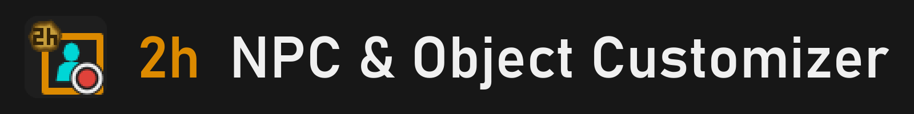
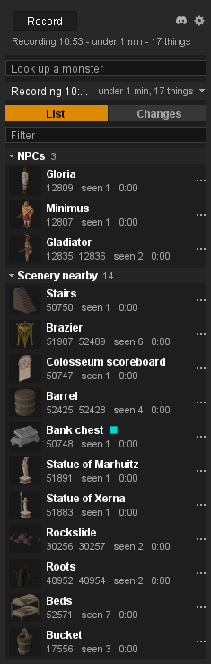
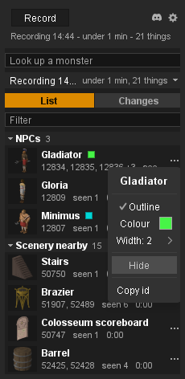

- Record while you play, then see every NPC and object you met, each with its picture. 
- Outline or hide a named one from its row, and undo it from the Changes tab.

<table width="100%">
<tr>
<td valign="top">

## What it shows

- **Everything you met.** The NPCs, the objects that appeared and the scenery near you, one row each, with a picture drawn from the game's own model, its ids, how often it was seen and when.
- **Shown only.** The effects, NPC animations and your own spells from the recording, listed so you can see them.
- **Look-up.** Type a monster's name to list it and the monsters linked on its wiki page, without recording.
- **Changes.** Every outline and hide you have made, each with Undo.

## Quick guide

1. **Record.** Press Record and play. The top line counts what was seen; the list appears when you press Stop.
2. **Find it.** Type in Filter to narrow the list. The bar above List picks an earlier recording or look-up.
3. **Outline.** Press "..." on a row and tick Outline. Pick a colour and a width from 1 to 6.
4. **Hide.** In the same menu: Hide for an NPC; Hide here or Hide everywhere for an object.
5. **Undo.** The Changes tab lists every change. Undo removes one; Undo all removes them all.

## Good to know

- **Named things only.** Only NPCs and objects with a game name can be outlined or hidden. Things with no name are listed but cannot be changed.
- **Where it applies.** An NPC is outlined or hidden wherever its name appears. An object is outlined at the places it was seen, and hidden there or everywhere by name.
- **No right-click edits.** Every change is made from the sidebar; the game's menus are left alone.
- **Kept.** Your changes are saved and come back after a restart. Recordings are not saved: the last five recordings and the last five look-ups are kept until you close the client.
- **Privacy.** Other players are never recorded or listed. The look-up sends only the name you type to the OSRS wiki, for names, ids and pictures; turn it off with "Use the OSRS wiki" in the settings.
- **Your icon.** Pick the sidebar button's picture from ten in the settings menu, under Sidebar icon.
- **Something wrong?** Tell us in the 2hBuilds Discord - the link is in the settings menu.

</td>
<td width="28"></td>
<td align="right" valign="top" width="235">

 

</td>
</tr>
</table>

 

<table width="100%">
<tr><td colspan="3"></td></tr>
<tr>
<td valign="top">

## A row's menu

- **Press "..." on a row.** The menu opens with the thing's name, then what you can do with it.
- **Outline** with any colour from RuneLite's colour picker and a width from 1 to 6.
- **Hide** an NPC, or an object here or everywhere. **Show** puts it back.
- **A badge** after the name shows a row's outline colour or that it is hidden.
- **Copy id** puts its ids on your clipboard. A row from the wiki can also be removed from the list.
- **Cannot be changed?** The menu says why: no name, not allowed by the Plugin Hub, or shown only.

</td>
<td width="28"></td>
<td align="right" valign="top" width="235">

 

</td>
</tr>
</table>

---

<strong>Found a bug or have an idea?</strong> Join the <a href="https://discord.gg/nsam4CfWzf">2hBuilds Discord</a>.

Want every row, menu and setting explained? Read the <a href="https://github.com/2hBuilds/scene-customizer/blob/main/DETAILS.md">full details</a>.
